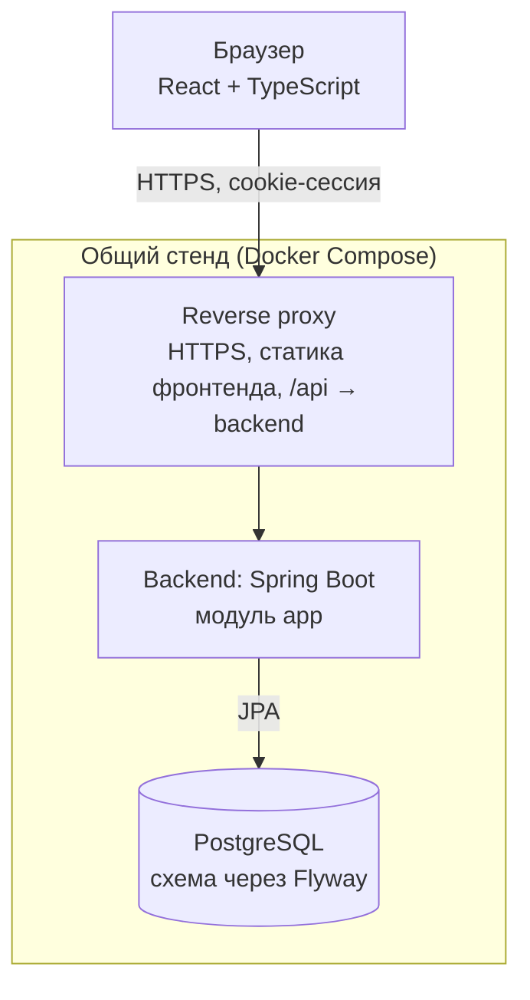
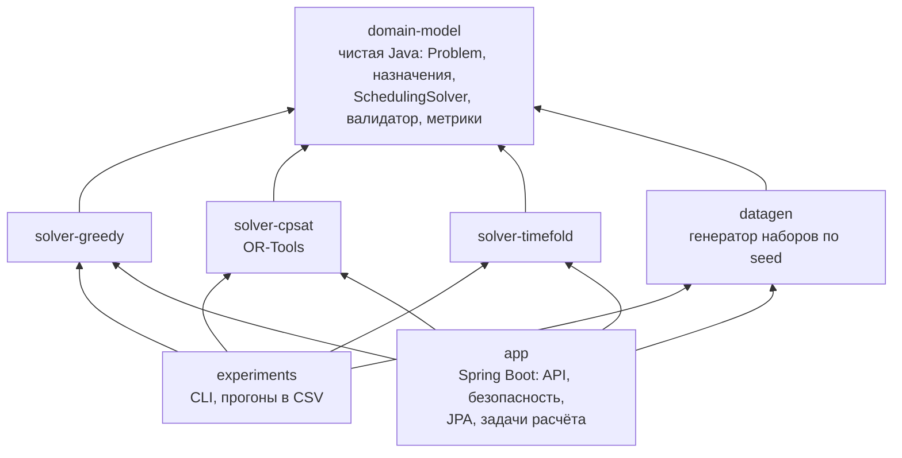

# Архитектура

Модульный монолит: один Spring Boot сервис и одна PostgreSQL, развёрнутые вместе с фронтендом на общем стенде. Солверы вынесены в Gradle-модули на чистой Java и не знают о Spring, БД и HTTP ([D-10](DECISIONS.md#d-10)).

## Компоненты



Фронтенд и API отдаются с одного домена: proxy отдаёт статику и проксирует `/api` на бэкенд. Поэтому не нужен CORS, а cookie сессии работает без дополнительных настроек. Прогресс расчёта приходит через SSE по тому же домену.

## Gradle-модули бэкенда



| Модуль | Содержимое | Зависимости |
| --- | --- | --- |
| `domain-model` | Входные данные солвера (`Problem`), назначения, результат, интерфейс `SchedulingSolver`, валидатор и метрики | Только JDK (и Lombok) |
| `solver-greedy` | Жадный солвер | `domain-model` |
| `solver-cpsat` | Модель CP-SAT, предпроверки на её основе, объяснение невыполнимости | `domain-model`, OR-Tools |
| `solver-timefold` | Солвер на Timefold | `domain-model`, Timefold |
| `datagen` | Генератор синтетических наборов по seed: и `Problem` для экспериментов, и JSON данных вуза для демо | `domain-model` |
| `experiments` | Консольная программа: сетка прогонов, CSV | солверы, `datagen` |
| `app` | Spring Boot приложение | всё, кроме `experiments` |

Модули заводятся по мере работ: на старте `domain-model`, `solver-greedy`, `datagen`, `app`.

### Две модели данных

- **Доменная** (`domain-model`) — неизменяемые объекты, которые нужны солверу. Никаких JPA-аннотаций.
- **Модель хранения** (`app`) — JPA-сущности и таблицы. Шире доменной: учётные записи, статусы, запросы на перенос, версии вариантов.

`app` собирает `Problem` из сущностей на конкретной версии входных данных и сохраняет результат обратно в варианты. Изменения в части расписания согласуются между авторами обеих моделей.

### Пакеты в `app`

Код разложен по функциям, а не по слоям: внутри пакета лежат свои контроллер, сервис, репозиторий, сущности и DTO.

| Пакет | Что внутри |
| --- | --- |
| `auth` | Вход, выход, текущий пользователь, настройки Spring Security |
| `account` | Учётные записи, роли, управление администратором |
| `university` | Данные вуза: группы, аудитории, дисциплины, связи, учебное расписание; импорт JSON |
| `eventtype` | Справочник типов событий |
| `planning` | Сессии, участники, пул комиссии, события, занятость, правила |
| `solving` | Предпроверки, задачи расчёта, очередь, прогресс через SSE, сборка `Problem` |
| `schedule` | Варианты, назначения, ручная правка, фиксация, публикация, diff |
| `request` | Запросы на перенос |
| `scenario`, `export` | После MVP: «что если», .ics |
| `common` | Общие исключения, обработка ошибок, конфигурация |

## Как идёт расчёт

1. Организатор (или планировщик после закрытия сбора) создаёт задачу расчёта: сессия, версия входных данных, алгоритм, параметры.
2. Задача попадает в очередь. Одновременно выполняются не больше N расчётов (по умолчанию 1–2): CP-SAT загружает все ядра, а стенд общий.
3. Исполнитель собирает `Problem`, вызывает солвер и передаёт прогресс в SSE-поток задачи.
4. Результат проверяется валидатором, сохраняется как черновой вариант с метриками и ссылкой на версию данных.
5. Повторный запуск с теми же сессией, версией данных, алгоритмом и параметрами не создаёт новую задачу, а возвращает существующую.

Автоматический расчёт (UX-12): задача по расписанию раз в минуту находит сессии с истёкшим окном сбора и переводит их в статус «планирование» атомарным обновлением. Поэтому каждая сессия запускается один раз, даже если экземпляров несколько.

## Аутентификация и авторизация

Решение — [D-04](DECISIONS.md#d-04): серверные сессии в HttpOnly-cookie, а не JWT.

- **Вход.** `POST /api/auth/login` с email и паролем. Spring Security проверяет пароль через `DelegatingPasswordEncoder` (хэши вида `{bcrypt}...`, [D-03](DECISIONS.md#d-03)) и создаёт сессию.
- **Хранение сессий.** Сессии лежат в PostgreSQL (Spring Session JDBC), поэтому переживают передеплой.
- **Cookie.** HttpOnly, Secure, SameSite=Lax.
- **CSRF.** Токен в cookie `XSRF-TOKEN`, фронтенд возвращает его в заголовке `X-XSRF-TOKEN` (axios делает это сам).
- **Выход.** `POST /api/auth/logout` уничтожает сессию на сервере.
- **Смена роли или отключение учётной записи** завершает все её сессии (UX-03).
- **Права.** Роли проверяются на уровне URL и методов (`@PreAuthorize`). Доступ к сессии планирования — по владельцу (организатор) или участию (преподаватель, студент).
- **Первый администратор** создаётся при старте из переменных окружения, если администраторов нет.
- **Без авторизации доступны** только `/api/auth/login`, `/actuator/health` и документация API.

Почему не JWT:

1. **Отзыв прав.** UX-01 и UX-03 требуют мгновенно отзывать доступ.
2. **SSE.** Браузерный `EventSource` не умеет передавать заголовок `Authorization`.
3. **Хранение токена.** В `localStorage` его украдёт любой XSS.
4. **Нет нужды.** Stateless-токены нужны для распределённых сервисов, у нас модульный монолит на одном домене.

## API

Контракт — OpenAPI, генерируется из кода через springdoc ([D-13](DECISIONS.md#d-13)). Изменения API делаются сначала контрактом: контроллер с DTO и заглушкой мержится первым, фронтенд генерирует по спецификации TypeScript-типы (`openapi-typescript`), затем пишется реализация. Спецификация доступна на `/v3/api-docs`, Swagger UI — на `/swagger-ui.html`.

Ориентировочный список эндпоинтов (окончательный — в спецификации):

| Метод и путь | Назначение | UX |
| --- | --- | --- |
| `POST /api/auth/login`, `POST /api/auth/logout`, `GET /api/auth/me` | Вход, выход, текущий пользователь | 01 |
| `GET/POST/PATCH /api/admin/accounts` | Учётные записи, роли, пароли, отключение | 02, 03, 23 |
| `POST /api/admin/import?dryRun=` | Импорт данных вуза: предпросмотр и применение | 04 |
| `/api/admin/groups`, `/rooms`, … | Ручная правка данных вуза | 23 |
| `GET/POST/PUT /api/event-types` | Справочник типов событий | 07 |
| `GET/POST/PATCH /api/sessions` | Сессии организатора | 05 |
| `/api/sessions/{id}/participants`, `/commission-pool`, `/rooms`, `/events` | Подготовка сессии | 06, 08 |
| `GET /api/sessions/{id}/collection`, `POST .../collection/close` | Статусы ответов, досрочное закрытие | 10 |
| `GET/PUT /api/sessions/{id}/busy-intervals/me`, `POST .../me/submit` | Своя занятость | 09 |
| `PUT /api/sessions/{id}/rules` | Веса мягких ограничений | 11 |
| `POST /api/sessions/{id}/precheck` | Предпроверка | 11 |
| `POST /api/sessions/{id}/solve` | Запуск расчёта, возвращает задачу | 11 |
| `GET /api/jobs/{id}`, `GET /api/jobs/{id}/events` | Статус задачи, прогресс через SSE | 11 |
| `GET /api/variants/{id}` | Вариант: назначения, метрики, объяснения | 13 |
| `PATCH /api/variants/{id}/assignments/{eventId}` | Ручная правка и фиксация | 14 |
| `POST /api/variants/{id}/publish` | Публикация | 15 |
| `GET /api/me/schedule` | Моё расписание | 17 |
| `POST /api/sessions/{id}/change-requests`, `PATCH .../{requestId}` | Запрос на перенос и решение | 19 |
| `POST /api/variants/{id}/reschedule`, `GET /api/variants/{id}/diff?base=` | Перестроение и diff | 20 |
| `/api/sessions/{id}/scenarios`, `GET /api/me/schedule.ics` | После MVP | 21, 18 |

Ошибки возвращаются в формате Problem Details (RFC 9457).

## Формат импорта данных вуза

Ориентировочная структура (окончательная — в блоке B4). Все сущности сопоставляются по `externalId`, поэтому повторный импорт обновляет записи, а не дублирует их.

```json
{
  "accounts": [
    { "externalId": "s-1001", "email": "ivanov@example.org", "fullName": "Иванов Иван",
      "role": "STUDENT", "timezone": "Europe/Moscow", "passwordHash": "{bcrypt}$2a$10$..." }
  ],
  "groups": [ { "externalId": "P3410", "students": ["s-1001"] } ],
  "rooms": [ { "externalId": "1404", "building": "Кронверкский 49", "capacity": 30, "equipment": ["projector"] } ],
  "disciplines": [ { "externalId": "db", "name": "Базы данных" } ],
  "teaching": [ { "teacher": "t-17", "discipline": "db", "group": "P3410" } ],
  "supervision": [ { "student": "s-1001", "supervisor": "t-17" } ],
  "timetable": [
    { "account": "s-1001", "start": "2026-06-15T09:50:00+03:00", "end": "2026-06-15T11:20:00+03:00" },
    { "room": "1404", "start": "2026-06-15T09:50:00+03:00", "end": "2026-06-15T11:20:00+03:00" }
  ]
}
```

`passwordHash` необязателен: без него учётная запись создаётся без возможности входа. Генератор `datagen` создаёт такой файл с известными демо-паролями.

## Хранение

- Схема БД создаётся только миграциями Flyway; Hibernate работает с `ddl-auto=validate` ([D-11](DECISIONS.md#d-11)).
- Время хранится как `timestamptz`, в приложении — `Instant`; часовые поясы — названия IANA (`Europe/Moscow`).
- Версия входных данных — счётчик в сессии; меняющие данные операции его увеличивают.
- Конкурентные правки отсекаются оптимистической блокировкой (`@Version`).
- Соглашения по именованию и миграциям — в [DEVELOPMENT.md](DEVELOPMENT.md#база-данных-и-миграции).

## Стек

| Слой | Технологии |
| --- | --- |
| Backend | Java 25, Spring Boot 4.1, Spring Security + Spring Session JDBC, Spring Data JPA, Flyway, springdoc-openapi, Lombok |
| Солверы | Собственный greedy, Google OR-Tools (CP-SAT), Timefold Solver |
| Данные | PostgreSQL (фиксированная мажорная версия, одинаковая везде) |
| Frontend | React + TypeScript, Vite, MUI, MobX, TanStack Query; календарь на react-big-calendar или бесплатной части FullCalendar (вид по ресурсам там платный) |
| Тесты | JUnit 5, Mockito, Testcontainers, Playwright (e2e), Gatling (нагрузка) |
| Профилирование | JMH, JFR + JDK Mission Control, async-profiler, Micrometer |
| Инфраструктура | GitHub Actions, GHCR, Ansible, Docker Compose, общий стенд с reverse proxy и HTTPS, Prometheus + Grafana |

## Тестирование и профилирование

Тесты идут слоями:

- **Юнит-тесты** (JUnit, Mockito) — у каждого блока, пишет автор блока.
- **Интеграционные** — API с настоящей PostgreSQL в Testcontainers.
- **Контрактные** — контроллеры отдают ровно то, что в OpenAPI.
- **E2E** — сквозной сценарий организатора в браузере.
- **Нагрузочные** — нагрузка на API и массовые отмены для перестроения.

Каждый солвер в CI прогоняется валидатором на наборах S и M.

Профилирование должно показать на защите две вещи:

1. Время солверов растёт предсказуемо с размером набора.
2. Приложение не теряет память и выдерживает несколько одновременных расчётов.

Результат — отчёт с флеймграфами, графиками и замерами до и после оптимизаций.
